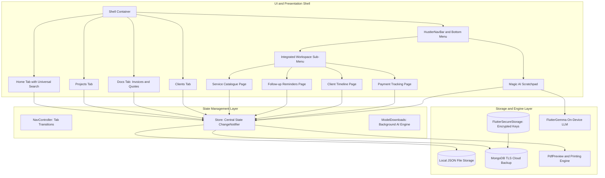
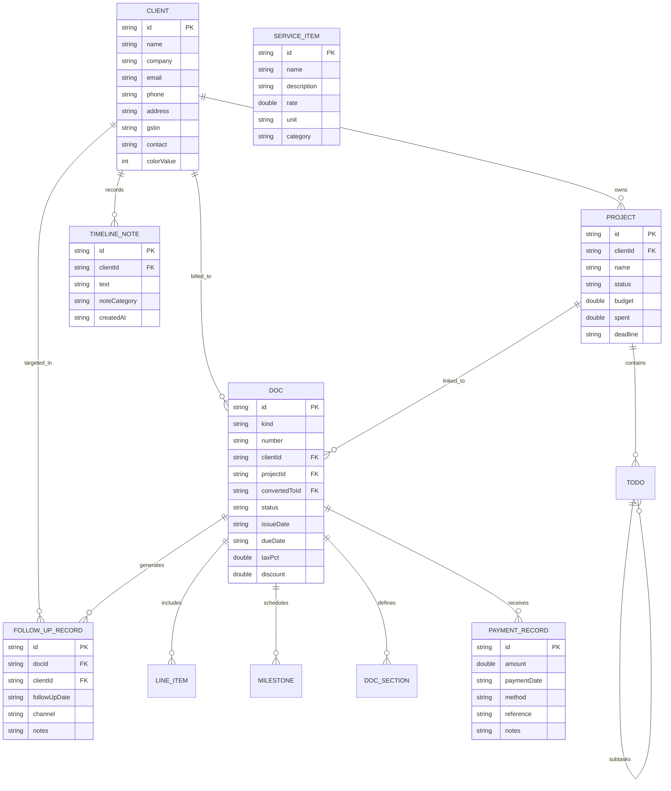
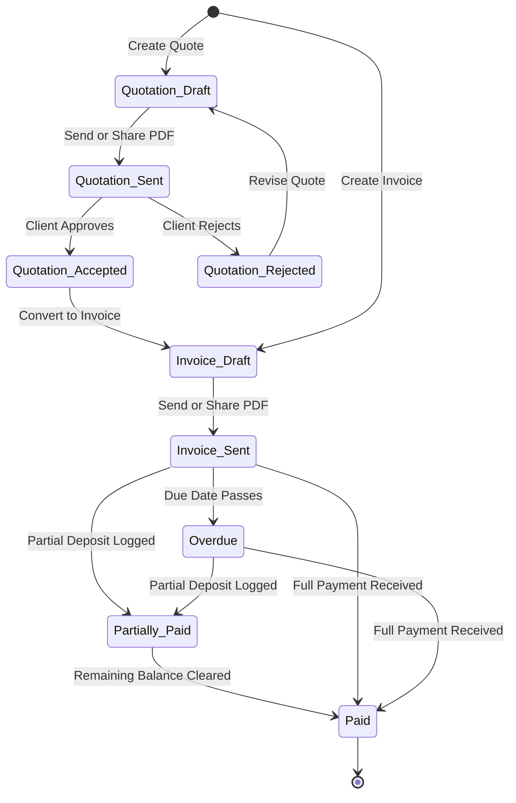
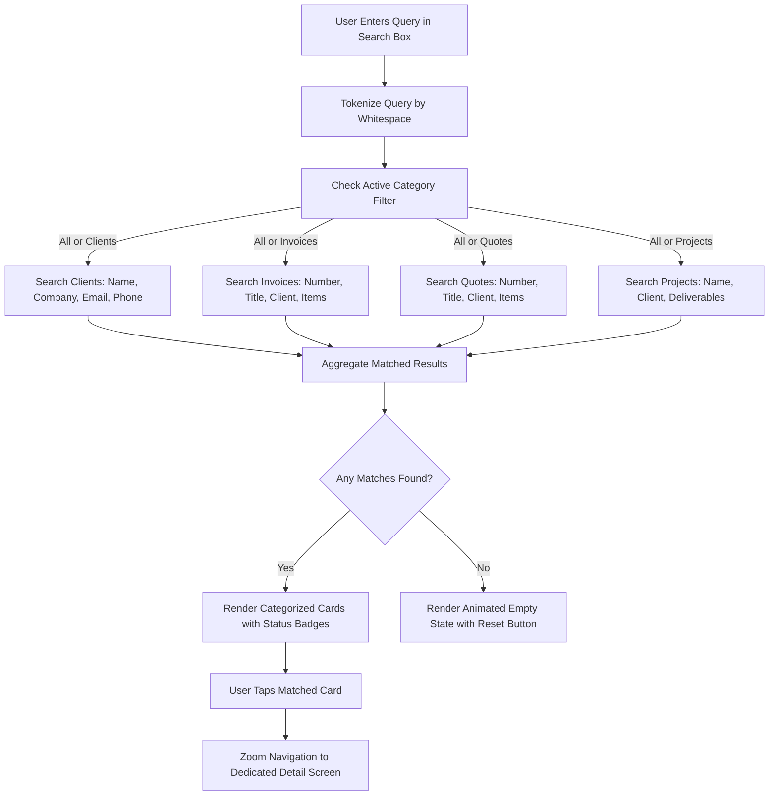

# Freelance OS (Hustler)

> **A high-performance, offline-first mobile operating system for independent consultants, studios, and freelancers.** Built with Flutter, on-device AI (Gemma 2B), encrypted cloud backup, and PDF document generation.

---

## Table of Contents

- [Overview](#overview)
- [Architecture & System Design](#architecture--system-design)
  - [High-Level System Architecture](#high-level-system-architecture)
  - [Entity Relationship Diagram (ERD)](#entity-relationship-diagram-erd)
  - [Document & Invoicing Lifecycle](#document--invoicing-lifecycle)
  - [Universal Search & Filtering Flow](#universal-search--filtering-flow)
- [Feature Guide](#feature-guide)
  - [1. Search & Multi-Entity Filters](#1-search--multi-entity-filters)
  - [2. Service Catalogue](#2-service-catalogue)
  - [3. Follow-up Reminders & Message Templates](#3-follow-up-reminders--message-templates)
  - [4. Client Timeline & Communication Log](#4-client-timeline--communication-log)
  - [5. Payment Tracking & Multi-Transaction Ledger](#5-payment-tracking--multi-transaction-ledger)
  - [6. Bottom Bar Workspace Sub-Menu](#6-bottom-bar-workspace-sub-menu)
  - [7. Magic Scratchpad & On-Device AI](#7-magic-scratchpad--on-device-ai)
  - [8. Professional PDF Generation & Templates](#8-professional-pdf-generation--templates)
  - [9. Encrypted MongoDB Cloud Backup](#9-encrypted-mongodb-cloud-backup)
- [Data Models & Schema Reference](#data-models--schema-reference)
- [Project Structure](#project-structure)
- [Getting Started](#getting-started)
  - [Prerequisites](#prerequisites)
  - [Installation & Setup](#installation--setup)
  - [Running the App](#running-the-app)
  - [Running Tests](#running-tests)
- [License](#license)

---

## Overview

Freelance OS is designed specifically for creative technologists, designers, software consultants, and solo founders who need complete control over their client relationships, projects, quotations, invoices, payments, and standard service pricing—without depending on expensive SaaS subscriptions.

### Core Highlights

| Capability | Description |
| :--- | :--- |
| **Offline-First Storage** | Instant zero-latency loading with atomic single-file JSON persistence (`freelance_os.json`). |
| **Universal Live Search** | Real-time multi-token keyword search across Clients, Invoices, Quotations, and Projects directly from the Home screen. |
| **Payment Tracking** | Fine-grained transaction tracking supporting full payments, partial deposits, transaction references (UTR/receipts), and payment methods. |
| **Service Catalogue** | Reusable service library with standard hourly/project rates and units for fast estimation. |
| **Smart Follow-Ups** | Automated detection of pending quotes and unpaid/overdue invoices with pre-formatted WhatsApp/Email templates. |
| **360° Client Timelines** | Chronological audit trail of past work, sent documents, received payments, and communication logs. |
| **On-Device Gemma 2B AI** | Local LLM intelligence that converts unstructured rough notes into line items, budgets, and project deliverables. |
| **Vector PDF Engine** | Pixel-perfect vector PDF generation with custom templates, sharing, and print support. |
| **Encrypted Cloud Backup** | TLS-encrypted MongoDB automated synchronization with AES-encrypted credential storage. |

---

## Architecture & System Design

### High-Level System Architecture



---

### Entity Relationship Diagram (ERD)



---

### Document & Invoicing Lifecycle



---

### Universal Search & Filtering Flow



---

## Feature Guide

### 1. Search & Multi-Entity Filters

Located right at the top of the **Home Screen**, the universal search engine provides instant keyword discovery across all workspace databases.

- **Dynamic Token Matching**: Multi-word queries like `acme invoice` or `ui design` match across names, deliverables, client companies, and status fields simultaneously.
- **Category Filter Pills**: Quickly toggle between `All`, `Clients`, `Invoices`, `Quotations`, and `Projects` with live match count badges.
- **Deep Linking**: Tapping any result card zooms directly into `ClientDetailPage`, `DocDetailPage`, or `ProjectDetailPage`.
- **Dashboard Restoration**: Clearing the search bar or tapping "Back to Dashboard" seamlessly restores cash-flow graphs and recent activity feeds.

---

### 2. Service Catalogue

The **Service Catalogue** (`lib/services_catalogue.dart`) empowers freelancers to standardize their rates and reuse common project offerings.

- **Categorized Library**: Organize services by `Development`, `Design`, `Maintenance`, `API`, `Consulting`, and `Other`.
- **Rate & Unit Modeling**: Store standard units (`hr`, `project`, `mo`, `screen`, `day`) alongside unit prices.
- **One-Tap Reuse**: Services can be inserted directly into documents or copied with one click.
- **CRUD Management**: Add, modify, or delete custom service offerings anytime from the bottom sub-menu.

---

### 3. Follow-up Reminders & Message Templates

The **Follow-Up Reminders** engine (`lib/follow_ups.dart`) helps close pending revenue without uncomfortable manual tracking.

- **Automated Pipeline Detection**:
  - Sent quotations awaiting client acceptance.
  - Sent invoices nearing due date.
  - Overdue invoices calculating exact days past due.
- **Smart Message Generator**: Pre-populates polite, personalized follow-up messages tailored to invoice balance, due date, and client name.
- **One-Tap Sharing & Logging**: Copy to clipboard or launch native OS share sheets (WhatsApp, Mail, Messages) while automatically recording a follow-up log.

---

### 4. Client Timeline & Communication Log

The **Client Timeline** (`lib/client_timeline.dart`) unifies past work history and communication in one chronological stream.

- **Comprehensive Audit Trail**:
  - Projects started, deadlines, and task completion milestones.
  - Quotations drafted, sent, accepted, or rejected.
  - Invoices issued, overdue flags, and payment transactions.
  - Communication entries (Calls, Meetings, Emails, and Notes).
- **Communication Logger**: Add timestamped call summaries, client feedback, or agreement decisions directly to the client's permanent record.
- **Client Switcher**: Switch between clients via an intuitive dropdown or access directly from any client detail card.

---

### 5. Payment Tracking & Multi-Transaction Ledger

The **Payment Tracking** suite (`lib/payment_tracking.dart`) gives visibility over cash flow and partial payments.

- **Detailed Status Segmentation**:
  - `Paid`: Invoices where received payments equal or exceed the invoice total.
  - `Partially Paid`: Invoices that received advance deposits with remaining balance due.
  - `Unpaid`: Sent invoices awaiting payment.
  - `Overdue`: Sent invoices past their scheduled payment date.
- **Payment Transaction Recording**: Log payments with amount received, payment date, method (`Bank Transfer`, `UPI`, `Credit Card`, `Cash`, `Cheque`, `PayPal`, `Stripe`), and UTR / reference numbers.
- **Live Progress Bars**: Visual progress indicators illustrating percentage paid vs outstanding balance.

---

### 6. Bottom Bar Workspace Sub-Menu

An elevated tool launcher situated on the right side of the bottom navigation bar (`lib/sub_menu.dart`).

- **Quick-Access Modal**: Opens a sheet granting access to:
  1. Service Catalogue
  2. Follow-up Reminders
  3. Client Timeline
  4. Payment Tracking
  5. Studio Settings & MongoDB Cloud Backup
- **Badge Indicators**: Notifies of pending follow-ups directly in the menu item.
- **Non-Intrusive Layout**: Preserves standard navigation tabs (`Home`, `Projects`, `Magic`, `Docs`, `Clients`) and gesture ergonomics.

---

### 7. Magic Scratchpad & On-Device AI

Powered by **Gemma 2B** running entirely on-device via `flutter_gemma`.

- **Unstructured Text Extraction**: Type or paste rough notes (e.g. `Logo design 8h @ $85, 3x illustrations @ $120, Net 14 for Acme Corp`) and convert them into structured line items, totals, and deliverables.
- **Privacy Guaranteed**: Model execution happens locally on the mobile GPU/CPU without transmitting client notes to third-party APIs.
- **Heuristic Fallback**: Deterministic regex parser guarantees instant note parsing even before local AI weights finish downloading.

---

### 8. Professional PDF Generation & Templates

- **Dynamic Vector Rendering**: Real-time PDF rendering utilizing `pdf` and `printing` packages.
- **Multi-Layout Aesthetics**: Switch between modern typographic templates (e.g., Clean, Minimal, Studio, Bold).
- **Native OS Integration**: Direct printing, local saving, and sharing via WhatsApp, AirDrop, or email clients.

---

### 9. Encrypted MongoDB Cloud Backup

- **Zero-Knowledge Credential Handling**: Encrypted storage of connection strings via `flutter_secure_storage`.
- **TLS Transport**: Connects directly via `mongodb+srv://` over secure TLS socket streams.
- **Lifecycle Auto-Backup**: Automatically takes database snapshots when the app moves to background mode after modifications.

---

## Data Models & Schema Reference

| Model | File | Primary Fields | Description |
| :--- | :--- | :--- | :--- |
| `Client` | `models.dart` | `id`, `name`, `company`, `email`, `phone`, `address`, `gstin`, `colorValue` | Client entity with visual avatar styling and billing info. |
| `Project` | `models.dart` | `id`, `clientId`, `name`, `status`, `budget`, `spent`, `deadline`, `todos` | Work project holding deliverable tasks, deadlines, and budget. |
| `Todo` | `models.dart` | `id`, `text`, `done`, `priority`, `hours`, `sub` | Hierarchical task and subtask breakdown with estimated hours. |
| `Doc` | `models.dart` | `id`, `kind`, `number`, `clientId`, `status`, `items`, `payments`, `taxPct`, `discount` | Unified document representing either an Invoice or Quotation. |
| `LineItem` | `models.dart` | `desc`, `qty`, `rate`, `unit`, `todoId` | Single itemized line on an invoice or quotation. |
| `PaymentRecord` | `models.dart` | `id`, `amount`, `date`, `method`, `reference`, `notes` | Specific payment transaction recorded against an invoice. |
| `ServiceItem` | `models.dart` | `id`, `name`, `description`, `rate`, `unit`, `category` | Reusable service definition in the Service Catalogue. |
| `TimelineNote` | `models.dart` | `id`, `clientId`, `text`, `type`, `date` | Logged communication entry (call, meeting, email, note). |
| `FollowUpRecord` | `models.dart` | `id`, `docId`, `clientId`, `date`, `channel`, `notes` | History of follow-up communications conducted for a document. |
| `Profile` | `models.dart` | `bizName`, `ownerName`, `email`, `currency`, `defaultTax`, `dueDays`, `hourlyRate` | Studio owner details, currency preferences, and default terms. |

---

## Project Structure

```
lib/
├── ai.dart                  # On-device Gemma AI parser and estimation engine
├── builder_widgets.dart     # Document creation and builder UI components
├── builders.dart            # Quote & Invoice builder workflow pages
├── client_timeline.dart     # Client Timeline & communication notes screen
├── clients.dart             # Client directory, ledger, and detail screens
├── cloud_backup.dart        # MongoDB TLS remote backup driver
├── docs.dart                # Invoices & Quotations lists, detail, and PDF actions
├── downloads.dart           # Background Gemma model weight downloader
├── follow_ups.dart          # Follow-up Reminders & smart message sheet
├── home.dart                # Home Tab: Top search & filters, health chart, feeds
├── intro.dart               # Startup animated splash experience
├── log.dart                 # Unified logging subsystem
├── magic.dart               # Magic Scratchpad interactive note parsing UI
├── main.dart                # App entrypoint, theme, Shell, and HustlerNavBar
├── models.dart              # Core data models, Store state & JSON persistence
├── motion.dart              # Spring animations, transitions, and curves
├── numwords.dart            # Number to currency text formatter (tax invoices)
├── payment_tracking.dart    # Payment Tracking ledger & recording modals
├── pdf.dart                 # Vector PDF layout engine and printable renderer
├── projects.dart            # Project boards, task trees, and deliverable tracker
├── services_catalogue.dart  # Service Catalogue catalog & rate manager
├── settings.dart            # Studio settings, cloud backup config, and backup export
├── state.dart               # NavController bottom navigation router
├── sub_menu.dart            # Bottom bar floating sub-menu modal
├── templates.dart           # PDF visual themes and document styling templates
├── ui.dart                  # Hustler Design System tokens, cards, and buttons
├── voice.dart               # Speech-to-text recording engine
├── voice_pack.dart          # Local voice model assets
└── voice_sherpa.dart        # Voice-assisted command engine
```

---

## Getting Started

### Prerequisites

- [Flutter SDK](https://docs.flutter.dev/get-started/install) (`>= 3.24.0`)
- [Dart SDK](https://dart.dev/get-dart) (`>= 3.5.0`)
- Android Studio / VS Code with Flutter extensions
- Android device or emulator with GPU support for local AI inference

### Installation & Setup

1. **Clone the Repository**:
   ```bash
   git clone https://github.com/your-username/freelance-os.git
   cd freelance-os
   ```

2. **Install Dependencies**:
   ```bash
   flutter pub get
   ```

3. **Configure Environment Secrets (Optional)**:
   Create a `.env` file in the project root if utilizing MongoDB cloud sync:
   ```env
   MONGODB_URI=mongodb+srv://<username>:<password>@cluster0.mongodb.net/hustler?retryWrites=true&w=majority
   ```
   *(Note: `.env` is automatically ignored in version control via `.gitignore`.)*

### Running the App

```bash
flutter run
```

### Running Tests

Execute the comprehensive widget and unit test suites:

```bash
# Run all test suites
flutter test

# Run specific functional test suites
flutter test test/home_magic_ui_test.dart
flutter test test/shell_ui_test.dart
```

---

## License

This project is licensed under the MIT License. See [LICENSE](LICENSE) for details.
